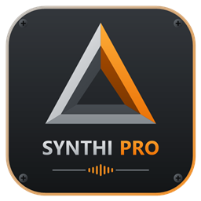

# SYNTHI PRO

Matrix modular software synthesizer for Windows 10/11 (x64): standalone application and VST3 plug-in.
Матричный модульный программный синтезатор для Windows 10/11 (x64): автономная программа и плагин VST3.



## Features / Возможности

- 3 VCOs (Sine, Triangle, Saw, Square, Pulse) with hard sync, phase FM and audio-rate cross-modulation
- White/pink noise, ring modulator, mixer
- Multimode filter: ladder LP 24 / 18 / 12 (self-oscillating), band-pass, high-pass, notch
- 3 ADSR envelopes, 2 LFOs, Sample & Hold
- 16 x 16 patch matrix with bipolar depth per pin
- 16-step sequencer, mono / legato / poly (up to 16 voices), glide
- Effects: distortion, saturation, phaser, chorus, delay, reverb, stereo width
- 156 factory presets in 13 categories, user presets, favorites, random patch
- EASY and PRO modes, English and Russian interface, resizable window
- WASAPI, DirectSound and ASIO in the standalone version

## Documentation / Документация

| | |
|---|---|
| User guide (EN) | [docs/USER_GUIDE_EN.md](docs/USER_GUIDE_EN.md) |
| Руководство пользователя (RU) | [docs/USER_GUIDE_RU.md](docs/USER_GUIDE_RU.md) |
| Installation and DAW setup / Установка и подключение к DAW | [docs/INSTALL.md](docs/INSTALL.md) |
| Building from source / Сборка из исходников | [docs/BUILD.md](docs/BUILD.md) |

## Building / Сборка

Requirements: Visual Studio 2022 with C++ tools, CMake 3.22+, [JUCE 8.0.4](https://github.com/juce-framework/JUCE/releases/tag/8.0.4).
The Steinberg ASIO SDK is optional. Neither SDK is included in this repository.

```bat
git clone --depth 1 --branch 8.0.4 https://github.com/juce-framework/JUCE.git JUCE
build.bat
```

The DSP engine has no dependencies and can be tested on its own:

```bat
tests\run_engine_test.bat
```

## Layout / Структура

| Path | Contents |
|---|---|
| `Source/dsp` | DSP engine, effects and the parameter table (plain C++17, no JUCE) |
| `Source` | plug-in processor, editor, factory presets |
| `tests` | stand-alone engine tests |
| `tools` | preset generator, icon generator |
| `installer` | Inno Setup script |
| `assets` | icons |

## License / Лицензия

Copyright (C) 2026 Khafizov Dinar.

SYNTHI PRO is free software, licensed under the GNU Affero General Public License version 3 — see
[LICENSE.txt](LICENSE.txt) and [COPYING.txt](COPYING.txt). It is distributed WITHOUT ANY WARRANTY.

SYNTHI PRO — свободное программное обеспечение под лицензией GNU AGPL версии 3. Программа поставляется
без каких-либо гарантий.

Built with [JUCE](https://juce.com). VST is a registered trademark of Steinberg Media Technologies GmbH.
ASIO is a trademark and software of Steinberg Media Technologies GmbH. SYNTHI PRO is an independent project,
not affiliated with or endorsed by EMS or Arturia.
